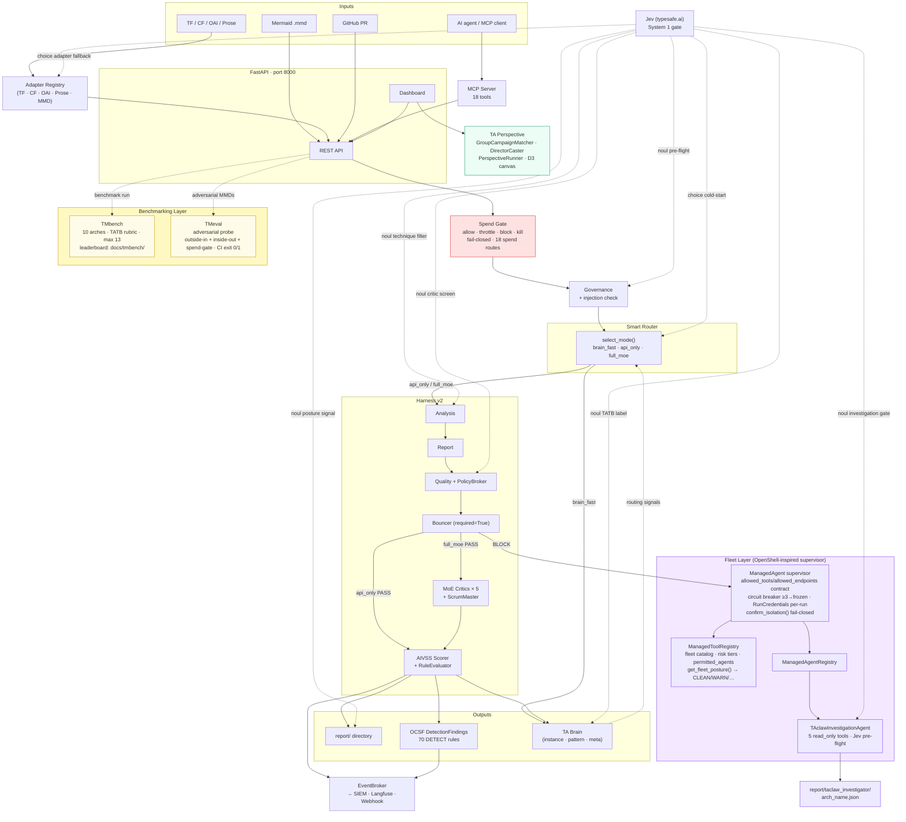

# ThreatAssessor

Submit a Mermaid (`.mmd`) diagram, a Git repo, or IaC files and receive a MITRE ATT&CK-mapped threat model, SOC detection signals, and optional MoE expert review — in under two minutes.

## What you get

- **Threat model** — MITRE ATT&CK techniques mapped per node and hop; deterministic, no LLM required
- **SOC signals** — 70 DETECT rules evaluated per run (grounded in OWASP, MITRE ATLAS, and CSA Agentic AI Red Teaming Guide); OCSF DetectionFinding 2004 events emitted to SIEM / Langfuse / webhook
- **Expert review** — 5-critic MoE panel (Architect / Tester / Red Team / Purple Team / Blackhat) + ScrumMaster synthesis, on demand
- **TA Brain** — self-growing knowledge graph that predicts findings for known topology patterns and drives smart routing
- **TAclaw** — autonomous repo assessment: point at a Git URL or directory; adapters (TF / CF / OAI / Prose / MMD) convert it to a graph and run the full pipeline; usable via REST, MCP tool, or `ta analyze` CLI
- **TMbench** — open benchmark for structured threat model output; 10 reference architectures across four tiers (T1–T4); TATB rubric (max 13 with ATLAS bonus); scores any tool; leaderboard at `docs/tmbench/`
- **TMeval** — adversarial red-team probe; outside-in (8 adversarial MMDs against the governance gate) + inside-out (21 injection cases, 3 threat-actor entry points into RuleEvaluator and BouncerStage) + spend-gate probe (kill switch, fail-closed policy, per-route gate coverage, with a mutation check that the old fail-open gate is caught); exits 0/1 for CI

## Architecture



Three pipeline modes: **brain_fast** serves predictions from the TA Brain for known topology patterns (~50ms); **api_only** runs the deterministic analysis pipeline; **full_moe** adds the 5-critic expert panel. The Smart Router selects the mode automatically based on Brain confidence and AIVSS history. **Jev** (typesafe.ai) augments eight decision points as a fast System 1 gate: governance injection detection, smart router cold-start, PolicyBroker critic pre-screening, adapter format fallback, TATB quality labelling, investigation pre-flight, technique applicability filtering, and CISO posture signal at export — all non-fatal; every point falls back silently if Jev is unavailable.

Every route that can spend LLM tokens passes a single **Spend Gate** first. It returns a verdict on a ladder (`allow < steer < throttle < block < kill`), not a boolean: `kill` (kill switch, HTTP 503), `block` (blocked architecture, or a policy file that is missing or unreadable, HTTP 403), `throttle` (per-caller soft limit, HTTP 429). It fails closed, and tests assert that each of the 18 spend routes carries it. Per-caller limits key on a self-asserted `TM-CALLER` label, so they stop accidental loops, not a determined abuser; per-caller keys are planned. `steer` is reserved and not yet produced.

On **BLOCK**, the pipeline hands off to the **Fleet Layer**: a managed agent loop where an LLM decides which tool to call next based on what the previous tool returned. `TAclawInvestigationAgent` queries five tools (block signals, brain patterns, rule detail, pipeline context, synthesis) and writes a remediation report to `report/taclaw_investigator/`. Fleet output is kept separate from pipeline output by design.

## Quick start

### Prerequisites

- Python 3.10+
- Two data files in `chatbot/data/` (not in the repo):

| File | Source | Size |
|---|---|---|
| `enterprise-attack.json` | [MITRE CTI releases](https://github.com/mitre/cti/tree/master/enterprise-attack) | ~44 MB |
| `technique_embeddings.npz` | Pre-computed — run `/build-embeddings-cache` after placing the JSON above | ~3 MB |

### Install and run

```bash
python3 -m venv .venv && source .venv/bin/activate
pip install -r requirements.txt
cp .env.example .env          # set API_KEY; add OPENROUTER_API_KEY for MoE review
make start                    # http://localhost:8000/dashboard
```

### Try it

33 sample `.mmd` diagrams in `tests/data/architectures/` cover cloud-native, zero-trust, IoT, agentic AI, data pipeline, multi-region, and microservices patterns.

```bash
curl -X POST http://localhost:8000/api/v1/analyze \
  -H "TM-API-KEY: your-key" \
  -F "architecture_file=@tests/data/architectures/00_serviceentry.mmd"
```

Deterministic analysis runs without an LLM key. Add `OPENROUTER_API_KEY` for MoE Expert Review.

## MCP server

Exposes ThreatAssessor as 18 tools to Claude Desktop and any MCP-compatible agent. REST API must be running first.

**Claude Desktop config** (`claude_desktop_config.json`):

```json
{
  "mcpServers": {
    "threatassessor": {
      "command": "python",
      "args": ["-m", "mcp_server.server"],
      "env": {
        "TM_API_BASE_URL": "http://localhost:8000",
        "TM_API_KEY": "your-key-here"
      }
    }
  }
}
```

Key tools:

| Tool | What it does |
|---|---|
| `analyze_architecture` | Submit `.mmd` → full threat model (~30s) |
| `governance_check` | Fast MMD governance scan (~50ms, no LLM) |
| `run_expert_review` | Queue FULL_MOE review, returns `job_id` |
| `get_detect_trends` | DETECT rule firing trends per architecture |
| `query_ta_brain` | Predict findings from corpus patterns |
| `export_assessment` | Full TA bundle (`ta-export/1.0`, OTM-compatible) |

Full tool list and per-client integration snippets: [`mcp_server/README.md`](mcp_server/README.md).

## Configuration

All variables documented in `.env.example`. Minimum required:

| Variable | Description |
|---|---|
| `API_KEY` | REST API auth (`openssl rand -hex 32`) |
| `LLM_PROVIDER` | `openrouter` \| `bedrock` \| `anthropic` \| `azure` |
| `OPENROUTER_API_KEY` | `sk-or-v1-...` — free tier at openrouter.ai |

Optional per-agent model overrides via `AGENT_MODEL_*`. Validate routing:

```bash
python3 .claude/skills/check-model-routing/scripts/check-model-routing.py
```

## Security notes

**API auth** — all endpoints require `TM-API-KEY` except `/health`. Generate: `openssl rand -hex 32`.

**MCP transport** — stdio (default) has no network exposure. Network transport (`--transport sse` / `--transport streamable-http`) requires `TM_MCP_KEY`.

**Spend gate** — one fail-closed gate on every spend route; the kill switch and per-caller limits live in `policies/agent_governance.yaml` under `bouncer:`. Limits are soft until per-caller keys exist.

**Governance gate** — `BouncerStage` (`required=True`) halts the pipeline on `CRITICAL` signals before the critic, ScrumMaster and AIVSS stages run. It sits after analysis, so it does not stop all spend; the spend gate above is the control that refuses a request before any work starts (REST routes only so far). 70 DETECT rules emit OCSF events for SOC consumption.

## Go deeper

- [`docs/ARCHITECTURE.md`](docs/ARCHITECTURE.md) — system structure: 13 layers, execution paths, design invariants, component diagram
- [`CLAUDE.md`](CLAUDE.md) — full module map, harness concepts, all check commands
- [`mcp_server/README.md`](mcp_server/README.md) — all 18 tools, 4-step test protocol, client integration snippets
- [`taclaw/README.md`](taclaw/README.md) — TAclaw CLI: `ta analyze`, `ta gate`, `ta export`
- [`policies/soc_detection_rules.yaml`](policies/soc_detection_rules.yaml) — 70 DETECT rules with OWASP/ATLAS/CSA ART/incident provenance
- [`docs/tmbench/`](docs/tmbench/) — open benchmark spec, 10 reference architectures, leaderboard (7 tools; ta_v3_1 2nd at 12.90/13)
- [`docs/BLOG_INDEX.md`](docs/BLOG_INDEX.md) — all published posts with what each covers
- [`docs/DECISIONS.md`](docs/DECISIONS.md) — architectural decision log (local only, gitignored)

## Build story

43 parts on Medium, from diagram to detection layer, with every design decision exposed. The full table is in [`docs/BLOG_INDEX.md`](docs/BLOG_INDEX.md).

Latest:

- Part 40: [The Scanner Saw Clean. The Pipeline Already Had.](https://medium.com/@breadtan/the-scanner-saw-clean-the-pipeline-already-had-521b8c2fc678)
- Part 41: [I Built the Benchmark. Then Lost to It.](https://medium.com/@breadtan/i-built-the-benchmark-then-lost-to-it-c611de098146)
- Part 42: [My Incident Heatmap Was Lying to Me: Fixing It Produced New Detection Rules](https://medium.com/@breadtan/my-incident-heatmap-was-lying-to-me-fixing-it-produced-new-detection-rules-8ab099e6a439)
- Part 43: [Built a Gym for My Skills. It Found Problems I Had Shipped.](https://medium.com/@breadtan/built-a-gym-for-my-skills-it-found-problems-i-had-shipped-4a004880719e)
